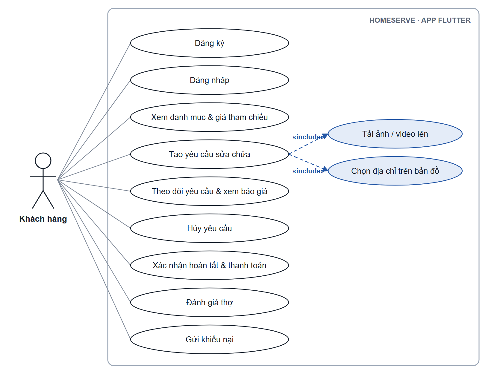
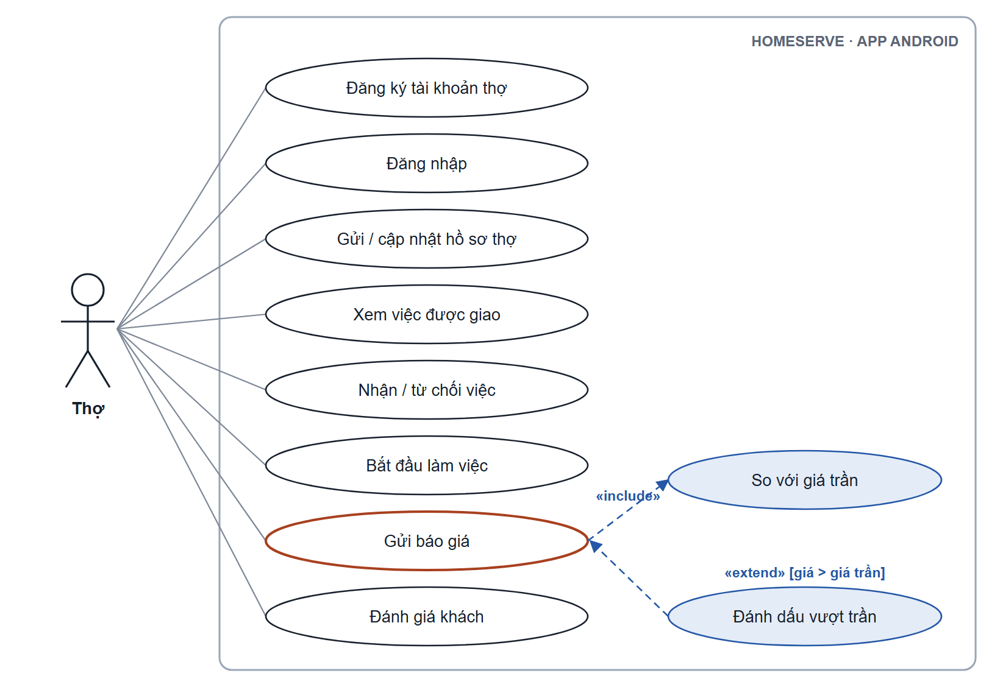
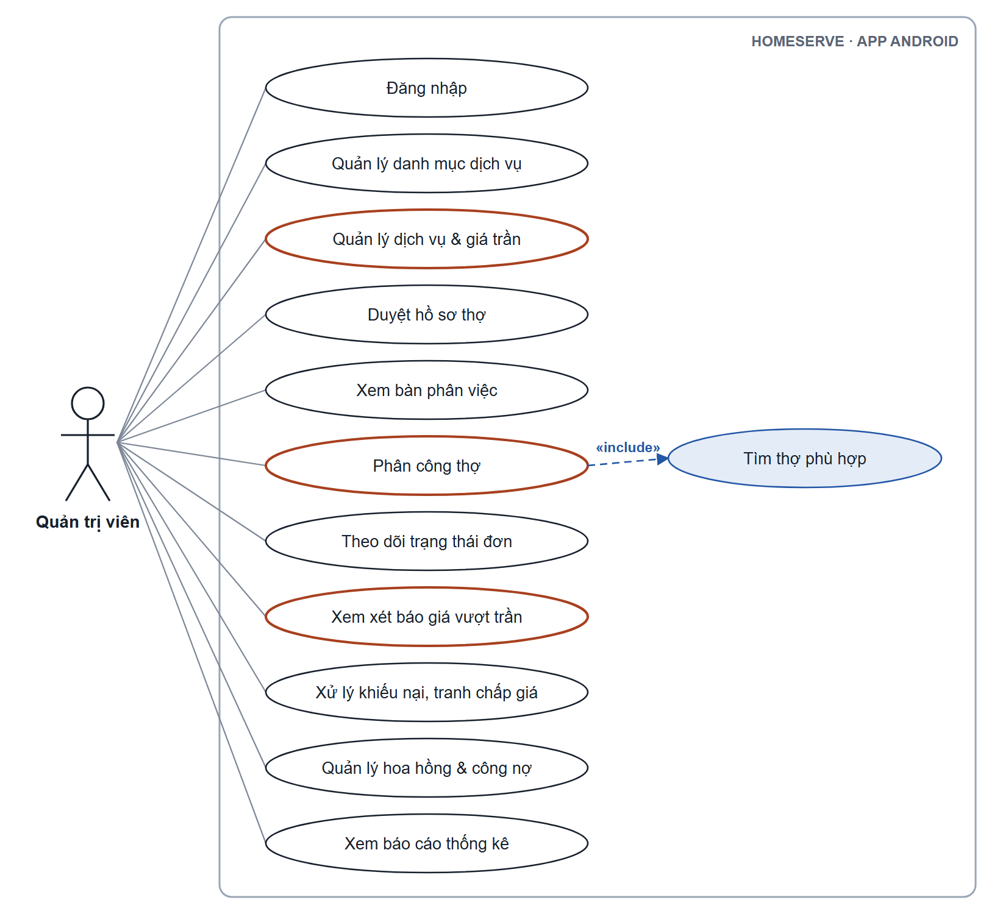
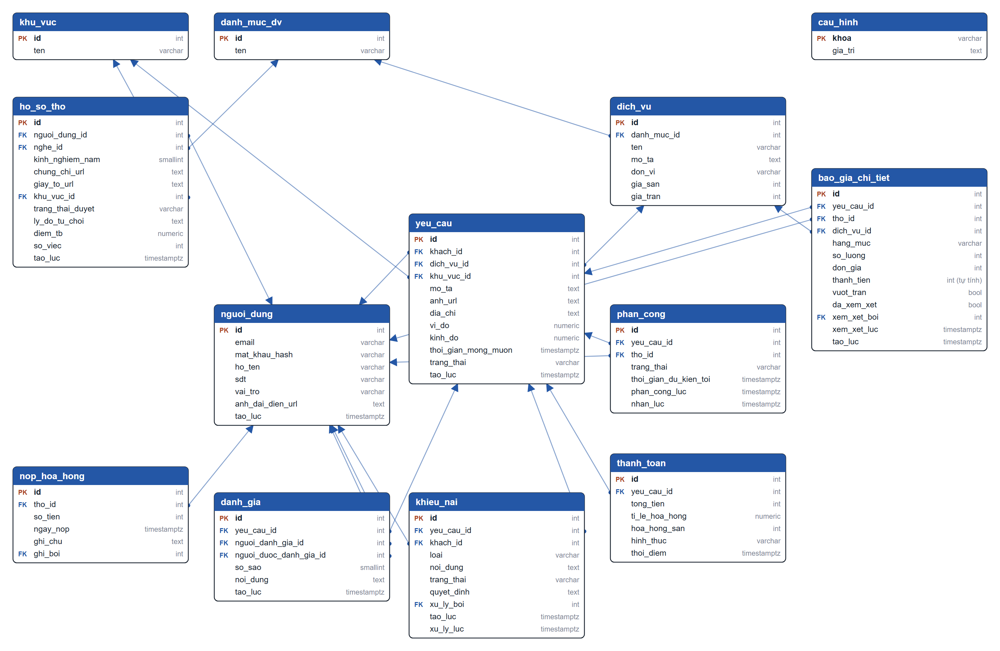

# HomeServe

**Nền tảng đặt dịch vụ sửa chữa tại nhà**: kết nối khách hàng với thợ điện, nước, máy lạnh… qua một **bảng giá tham chiếu công khai** và **đánh giá hai chiều**.

INT4211 – Lập trình trên các thiết bị di động · HK261 · Đồ án cuối kỳ · **Đề 14** · Nhóm **CTRL C CTRL V**

| | |
|---|---|
| API đang chạy | **https://homeserve-vm96.onrender.com** (kiểm tra: [`/health`](https://homeserve-vm96.onrender.com/health), [`/danh-muc-dv`](https://homeserve-vm96.onrender.com/danh-muc-dv)) |
| Bản phân tích tuần 9 (PDF) | [docs/tuan9/Chot-phan-tich-tuan9.pdf](docs/tuan9/Chot-phan-tich-tuan9.pdf) |

## Các nhánh

Mỗi phần nằm trên một nhánh riêng, các nhánh không merge vào nhau:

| Nhánh | Thư mục | Nội dung | Công nghệ |
|---|---|---|---|
| [`admin-android`](https://github.com/tuandinh2404/HomeServe/tree/admin-android) | `admin-android/` | App cho **Quản trị viên** và **Thợ** | Android, Java + XML, Retrofit |
| [`client-flutter`](https://github.com/tuandinh2404/HomeServe/tree/client-flutter) | `client-flutter/` | App cho **Khách hàng** | Flutter, Dart |
| [`backend`](https://github.com/tuandinh2404/HomeServe/tree/backend) | `backend/` | REST API dùng chung cho 2 app | Node.js + Express (TypeScript), PostgreSQL trên Supabase, deploy Render |

Hướng dẫn chạy và tài khoản thử nằm trong README của từng nhánh.

## Thành viên

| Thành viên | Phụ trách | Tỉ lệ |
|---|---|---|
| Nguyễn Đình Tuấn (nhóm trưởng) | Khung backend, đăng ký / đăng nhập, phân quyền, deploy; API đánh giá, khiếu nại, báo cáo, công nợ; khung app Android, màn báo cáo | 25% |
| Huỳnh Minh Tâm | Backend nghiệp vụ: danh mục, dịch vụ, hồ sơ thợ, yêu cầu, phân công + thợ phù hợp, báo giá vượt trần, thanh toán, dữ liệu mẫu | 25% |
| Nguyễn Hoàng Thông | App Android: đăng nhập, danh mục, duyệt hồ sơ thợ, phân việc, báo giá vượt trần, khiếu nại; các màn của Thợ | 25% |
| Nguyễn Duy Tuấn | App Flutter: đăng ký / đăng nhập, danh mục, tạo + theo dõi yêu cầu, thanh toán, đánh giá, khiếu nại | 25% |

---

# Phân tích hệ thống (bản nháp tuần 9)

Gồm 3 phần đề yêu cầu cho tuần 9: **sơ đồ use case · sơ đồ cơ sở dữ liệu · bảng phân công** (phần phân công ở mục *Thành viên* bên trên và mục 4 bên dưới). Bản đầy đủ có định dạng in nằm trong [file PDF](docs/tuan9/Chot-phan-tich-tuan9.pdf).

**Điểm nhấn kỹ thuật của đề 14:**
- ① Máy chủ **tự đánh dấu báo giá vượt giá trần** và đưa vào danh sách cần quản trị xem lại.
- ② Phân công **lọc thợ đúng nghề, đúng khu vực, có xét số sao**.

## 1. Tác nhân

| Tác nhân | Dùng | Vai trò |
|---|---|---|
| Khách hàng (`KHACH`) | App Flutter | Xem bảng giá, tạo yêu cầu, theo dõi, thanh toán, đánh giá thợ, khiếu nại |
| Thợ (`THO`) | App Android | Gửi hồ sơ chờ duyệt, nhận / từ chối việc, gửi báo giá, đánh giá khách |
| Quản trị viên (`QUAN_TRI`) | App Android | Danh mục, bảng giá, duyệt hồ sơ thợ, phân việc, xem xét báo giá vượt trần, khiếu nại, hoa hồng, báo cáo |

Mọi quy tắc nghiệp vụ (giá, quyền, trạng thái) do **máy chủ** quyết định; app chỉ hiển thị và gửi yêu cầu.

## 2. Sơ đồ use case

Elip viền đỏ: use case thuộc điểm nhấn của đề. Elip nền xanh nối nét đứt: «include» (luôn xảy ra) / «extend» (chỉ khi có điều kiện).

**Khách hàng (app Flutter)**

**Thợ (app Android)**

**Quản trị viên (app Android)**

## 3. Mô tả các use case quan trọng

<b>UC-01. Đăng nhập</b> (Khách hàng, Thợ, Quản trị viên)

- **Tiền điều kiện:** đã có tài khoản.
- **Luồng chính:**
  1. Nhập email và mật khẩu; app kiểm tra không bỏ trống, email đúng định dạng.
  2. Máy chủ tìm tài khoản theo email, so mật khẩu với bản băm bcrypt.
  3. Máy chủ trả token JWT (hạn 7 ngày) kèm họ tên và vai trò.
  4. App lưu token, mở màn theo vai trò: Quản trị → 4 tab, Thợ → 2 tab. Lần mở sau vào thẳng.
- **Luồng lỗi:** sai email hoặc mật khẩu → 401 cùng một câu "Email hoặc mật khẩu không đúng" · tài khoản khách đăng nhập app Android → bị chặn · token hết hạn → 401, app tự về màn đăng nhập.
- **API:** `POST /auth/dang-nhap`, `GET /auth/toi`

<b>UC-02. Tạo yêu cầu sửa chữa</b> (Khách hàng)

- **Tiền điều kiện:** khách đã đăng nhập.
- **Luồng chính:**
  1. Chọn danh mục, dịch vụ, xem giá tham chiếu (giá sàn – giá trần).
  2. Mô tả sự cố, đính kèm ảnh / video ngắn (tải lên Supabase Storage).
  3. Chọn địa chỉ trên bản đồ hoặc nhập tay, khu vực, thời gian mong muốn.
  4. Máy chủ kiểm tra dữ liệu, tạo yêu cầu ở trạng thái **Chờ nhận**.
- **Luồng lỗi:** thiếu / sai dữ liệu → 400 kèm tên ô sai · ảnh sai định dạng hoặc quá lớn → bị từ chối.
- **API:** `GET /danh-muc-dv`, `GET /dich-vu/:id/bang-gia`, `POST /tai-len`, `POST /yeu-cau`

<b>UC-03. Phân công thợ phù hợp</b> (Quản trị viên) · điểm nhấn ②

- **Tiền điều kiện:** yêu cầu đang Chờ nhận, chưa có phân công còn hiệu lực.
- **Luồng chính:**
  1. Quản trị mở bàn phân việc, lọc theo trạng thái và khu vực, chọn một yêu cầu.
  2. **Máy chủ** tìm thợ: hồ sơ đã duyệt, nghề trùng danh mục của dịch vụ, khu vực trùng khu vực yêu cầu; sắp theo số sao giảm dần rồi số việc đã làm.
  3. Quản trị chọn thợ, xác nhận; máy chủ tạo phân công **Chờ thợ nhận**.
- **Luồng lỗi:** không có thợ phù hợp → danh sách rỗng · yêu cầu đã có phân công hiệu lực → 409 (CSDL chặn bằng chỉ mục duy nhất có điều kiện) · thợ từ chối → giao lại cho thợ khác.
- **API:** `GET /yeu-cau?trangThai=&khuVuc=`, `GET /yeu-cau/:id/tho-phu-hop`, `PATCH /yeu-cau/:id/phan-cong`

<b>UC-04. Gửi báo giá</b> (Thợ) · điểm nhấn ①

- **Tiền điều kiện:** thợ đã nhận việc của yêu cầu này.
- **Luồng chính:**
  1. Thợ thêm các dòng: dịch vụ / hạng mục, số lượng, đơn giá (app hiện giá tham chiếu).
  2. «include» **So với giá trần:** với mỗi dòng, máy chủ đặt `vuot_tran = đơn giá > giá trần`; `thanh_tien` do CSDL tự tính.
  3. Máy chủ lưu và trả các dòng kèm cờ vượt trần.
- **Luồng thay thế:** «extend» **Đánh dấu vượt trần:** dòng vượt trần vẫn lưu nhưng vào danh sách cần quản trị xem lại (UC-05) · số lượng / đơn giá ≤ 0 → 400 · không phải thợ được giao → 403.
- **API:** `POST /bao-gia-chi-tiet`

<b>UC-05. Xem xét báo giá vượt trần</b> (Quản trị viên) · điểm nhấn ①

- **Luồng chính:** danh sách dòng vượt trần chưa xem xét → hiện giá thợ đưa so với giá trần và mức chênh → quản trị xác nhận (có hỏi lại) → máy chủ ghi đã xem xét, người và thời điểm.
- **Luồng thay thế:** khách cho rằng giá vượt bảng giá → gửi khiếu nại loại "Giá vượt trần".
- **API:** `GET /bao-gia-chi-tiet?vuotTran=true&daXemXet=false`, `PATCH /bao-gia-chi-tiet/:id/xem-xet`

<b>UC-06. Xác nhận hoàn tất và thanh toán</b> (Khách hàng) · transaction

- **Tiền điều kiện:** yêu cầu đang ở trạng thái Đang làm.
- **Luồng chính:** khách xem báo giá chi tiết, chọn tiền mặt / chuyển khoản → máy chủ mở **một transaction**: tính tổng, đọc tỉ lệ hoa hồng, ghi thanh toán, chuyển yêu cầu sang **Hoàn tất**, tăng số việc của thợ → COMMIT.
- **Luồng lỗi:** lỗi ở bất kỳ bước nào → ROLLBACK toàn bộ · đã thanh toán → 409 (UNIQUE) · không ở Đang làm → 409.
- **API:** `POST /thanh-toan`

## 4. Thiết kế cơ sở dữ liệu

PostgreSQL trên Supabase, **13 bảng, 22 khóa ngoại**. Mã tạo bảng: [`backend/sql/schema.sql`](https://github.com/tuandinh2404/HomeServe/blob/backend/backend/sql/schema.sql) (chạy lại được từ đầu); dữ liệu mẫu: [`seed.sql`](https://github.com/tuandinh2404/HomeServe/blob/backend/backend/sql/seed.sql), [`seed-tai-khoan.sql`](https://github.com/tuandinh2404/HomeServe/blob/backend/backend/sql/seed-tai-khoan.sql).

*Mũi tên đi từ cột khóa ngoại (FK) tới khóa chính (PK). Lược bỏ 3 khóa ngoại ghi "người xử lý" (`xem_xet_boi`, `ghi_boi`, `xu_ly_boi`) cho dễ đọc; bảng khóa ngoại đầy đủ có trong file PDF.*

| Bảng | Ý nghĩa |
|---|---|
| `nguoi_dung` | Tài khoản cả 3 vai trò; mật khẩu chỉ lưu dạng băm bcrypt |
| `khu_vuc` | Khu vực nhận việc; bảng riêng để yêu cầu và thợ so khớp chính xác |
| `danh_muc_dv` | Nhóm dịch vụ (Điện, Nước…), cũng là "nghề" của thợ |
| `dich_vu` | Dịch vụ + bảng giá tham chiếu: giá sàn, giá trần, đơn vị |
| `ho_so_tho` | Nghề, kinh nghiệm, chứng chỉ, giấy tờ, khu vực, trạng thái duyệt, điểm trung bình |
| `yeu_cau` | Yêu cầu sửa chữa, 5 trạng thái: Chờ nhận → Đã nhận → Đang làm → Hoàn tất / Hủy |
| `phan_cong` | Giao việc cho thợ, thợ nhận / từ chối, giờ dự kiến tới |
| `bao_gia_chi_tiet` | Từng dòng báo giá; `vuot_tran` do máy chủ tính (①), `thanh_tien` tự sinh |
| `thanh_toan` | 1 lần / yêu cầu; tổng tiền, tỉ lệ và tiền hoa hồng |
| `nop_hoa_hong` | Thợ nộp hoa hồng; công nợ = tổng hoa hồng − đã nộp |
| `danh_gia` | Đánh giá hai chiều, 1–5 sao |
| `khieu_nai` | Khiếu nại, tranh chấp giá, quyết định xử lý |
| `cau_hinh` | Cấu hình chung (tỉ lệ hoa hồng) |

**Ràng buộc chính:**
- `dich_vu`: `gia_san > 0`, `gia_tran ≥ gia_san`; không xóa được danh mục còn dịch vụ (RESTRICT).
- `phan_cong`: mỗi yêu cầu tối đa **1 phân công đang hiệu lực** (chỉ mục duy nhất có điều kiện); thợ từ chối thì giao lại được.
- `bao_gia_chi_tiet`: `thanh_tien = so_luong × don_gia` là cột tự sinh; `vuot_tran` bắt buộc, do máy chủ đặt.
- `thanh_toan`: mỗi yêu cầu thanh toán 1 lần; tỉ lệ hoa hồng được chép lại lúc thanh toán.
- `danh_gia`: mỗi bên đánh giá 1 lần / yêu cầu, không tự đánh giá mình.
- Tiền là `INTEGER` (VND), thời gian `TIMESTAMPTZ`; bật Row Level Security trên mọi bảng, mọi truy cập đi qua backend.

## 5. Kế hoạch theo tuần

| Tuần | Đình Tuấn | Tâm | Thông | Duy Tuấn |
|---|---|---|---|---|
| 8–9 | Khung backend, CSDL 13 bảng, 3 API xem, deploy Render, đăng nhập; khung app Android | Đọc khung, chạy trên máy; sửa dữ liệu mẫu | Chuyển bàn phân việc vào khung; đăng nhập | Giao diện app khách hàng |
| 10 | Thợ đăng ký; chốt `api.md` | Thêm / sửa / xóa danh mục, dịch vụ | Danh mục + bảng giá | Nối đăng nhập, danh mục |
| **11** | **Mốc kiểm tra: backend đã deploy + ≥ 3 API thật + mỗi app 2 màn hình** | | | |
| 12–13 | API đánh giá, khiếu nại, báo cáo, công nợ; màn báo cáo | Hồ sơ thợ, yêu cầu, phân công ②, báo giá ①, thanh toán | Hồ sơ / duyệt thợ, việc của thợ, phân việc, báo giá | Tạo yêu cầu, chi tiết, hủy, thanh toán |
| 14–15 | Kiểm thử phân quyền, báo cáo, video | Dữ liệu mẫu đủ đề | Khiếu nại, rà lỗi | Đánh giá, khiếu nại, rà lỗi |
